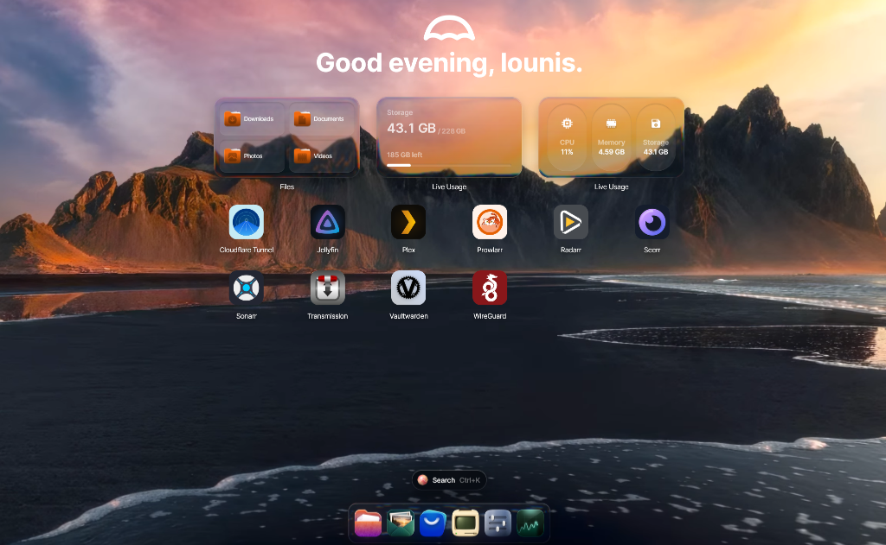
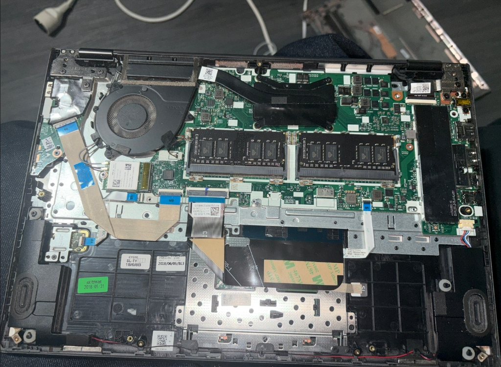
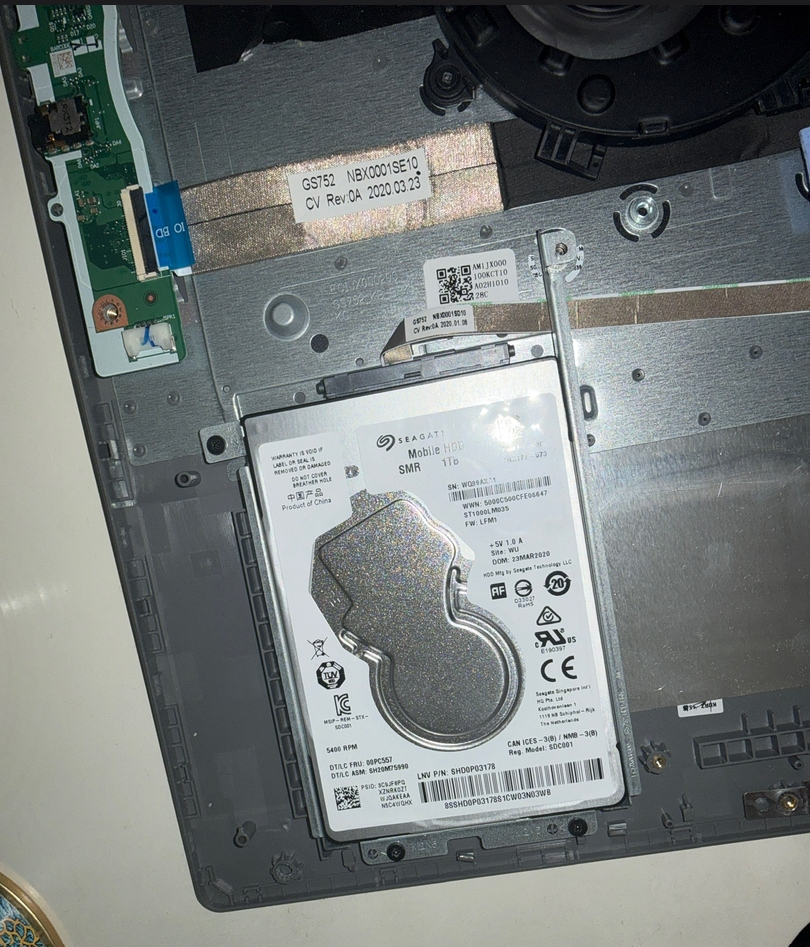

# 🖥️ DIY Laptop NAS & Home Lab — UmbrelOS

<p align="center">
  
</p>

<p align="center">
  
  
  
  
  
  
</p>

---

## 🌟 Présentation du Projet

Ce projet documente la transformation et l'optimisation d'un **ancien ordinateur portable reconditionné en un serveur NAS / Home Lab domestique complet, économe en énergie et 100% autonome**.

L'objectif principal est d'atteindre une **souveraineté numérique totale** : s'affranchir des abonnements payants et des géants du cloud (Netflix, Google Drive, 1Password, VPN commerciaux) en hébergeant soi-même, chez soi, l'intégralité de ses services essentiels (streaming, coffre-fort de mots de passe, cloud personnel, automatisation et VPN).

---

## 🛠️ Le Choix du Matériel : Recycler un Ordinateur Portable

Pourquoi utiliser un ordinateur portable comme base de NAS ?
* 🔋 **Onduleur naturel (UPS)** : La batterie intégrée du PC portable sert de protection immédiate contre les micro-coupures de courant.
* ⚡ **Très faible consommation électrique** : Conçu pour être mobile, le processeur et la carte mère consomment entre 15W et 30W en continu, soit une facture électrique minimale pour un serveur qui tourne 24h/24 et 7j/7.
* 💻 **Console de secours intégrée** : Écran et clavier toujours prêts en cas de dépannage sans avoir à brancher d'écran externe.

### 📸 Photos du Hardware

| Vue interne : Carte mère & Refroidissement | Baie de stockage : Disque dur Seagate 1 To |
| :---: | :---: |
|  |  |

### 🔧 Configuration Matérielle
* **Châssis & Carte Mère** : PC portable Lenovo reconditionné avec refroidissement actif dépoussiéré.
* **Stockage** :
  * SSD NVMe / SATA rapide pour le système d'exploitation et les bases de données Docker.
  * Disque dur **Seagate Mobile HDD 1 To (5400 RPM, SATA 2.5")** monté dans la baie interne pour les médias volumineux.
* **Réseau** : Connexion filaire Ethernet Gigabit branchée sur le routeur.

---

## 🧠 L'Évolution Logicielle : De Proxmox VE à UmbrelOS

Le serveur a connu une transition d'architecture majeure :

```text
[Début] Proxmox VE (Hyperviseur Type-1)
   ├── VM Debian (Jellyfin, Plex)
   ├── VM Ubuntu (Radarr, Sonarr, Transmission)
   └── Containers LXC
   ❌ Problème : Surcharge de virtualisation sur CPU mobile, RAM fragmentée, maintenance lourde

               ⬇️  Migration réfléchie

[Actuel] UmbrelOS (Bare-metal Linux / Docker)
   ├── Stack Conteneurisée unifiée (Docker & Compose)
   ├── Dashboard Web moderne & monitoring en direct
   └── ✅ Gain : 100% des ressources allouées aux applications réelles, réactivité maximale
```

### Pourquoi avoir quitté Proxmox pour UmbrelOS ?
1. **Économie de ressources matérielles** : Sur un processeur d'ordinateur portable, l'hyperviseur Proxmox et la multiplication des systèmes invités (VMs) consommaient des ressources précieuses.
2. **Gain de ressources logicielles** : UmbrelOS exécute les services directement via Docker sous Linux sans aucune couche d'émulation ou de virtualisation superflue.
3. **Simplicité et robustesse** : Un dashboard web unifié, des mises à jour en un clic et un magasin d'applications communautaire complet.

---

## 📦 Services Auto-Hébergés (Stack Docker Active)

Le serveur fait tourner en continu une suite complète de micro-services conteneurisés :

| Service | Rôle & Utilité |
| :--- | :--- |
| 🟣 **Jellyfin** | Serveur de streaming multimédia souverain et sans tracking (Films, Séries, Musique). |
| 🟡 **Plex** | Serveur multimédia alternatif pour le transcodage et la compatibilité étendue. |
| 👁️ **Seerr / Overseerr** | Portail de découverte et de demande de films et séries avec intégration TMDB. |
| 🎬 **Radarr** | Recherche, récupération et organisation automatisée des films. |
| 📺 **Sonarr** | Suivi, calendrier des sorties et automatisation des épisodes de séries TV. |
| 🔍 **Prowlarr** | Gestionnaire centralisé d'indexeurs et de trackers torrents. |
| ⚡ **Transmission** | Client de téléchargement BitTorrent ultra-léger et silencieux. |
| 🔒 **Vaultwarden** | Gestionnaire et coffre-fort de mots de passe chiffré (compatible Bitwarden). |
| 🛡️ **WireGuard** | Passerelle VPN moderne permettant de rejoindre le réseau local depuis n'importe où. |
| 🌐 **Cloudflare Tunnel** | Accès distant sécurisé (chiffrement SSL) sans ouvrir de port sur la box. |

---

## 📺 Client TV Dédié : Plezy TV

Pour profiter de la médiathèque Jellyfin et d'Overseerr directement sur la télévision du salon (Amazon Fire TV Stick), un client natif sur mesure a été développé :

👉 **[Voir le projet Plezy TV sur GitHub](https://github.com/louniscrt/plezy-tv)**
* Interface fluide inspirée d'Apple TV & Infuse 8.
* Optimisé chirurgicalement pour les sticks TV à mémoire limitée (1 Go de RAM).
* Bouton de demande de médias en direct connecté à Seerr ➔ Radarr/Sonarr.

---

## 🚀 Améliorations en Cours & Feuille de Route

Ce Home Lab est un projet vivant en perfectionnement constant :

- [x] Recyclage du PC portable et installation du premier disque dur 1 To.
- [x] Migration de Proxmox VE vers UmbrelOS pour maximiser les ressources.
- [x] Déploiement de la stack complète de streaming & automatisation (Jellyfin, Arr suite, WireGuard).
- [ ] **Hardware** : Achat et ajout de barrettes de RAM supplémentaires (passage à 16 / 32 Go double canal).
- [ ] **Stockage** : Ajout de disques durs externes / boîtier DAS multi-baies pour étendre la capacité de stockage.
- [ ] **Sauvegarde** : Mise en place d'une stratégie de backup 3-2-1 automatisée (chiffrement hors-site).
- [ ] **Autonomie Totale** : Hébergement de services de synchronisation cloud (Nextcloud / Immich) pour remplacer Google Photos et iCloud.

---

## 📄 Licence

Ce projet est partagé sous licence **MIT**. N'hésitez pas à vous en inspirer pour vos propres projets de Home Lab et de recyclage matériel !
